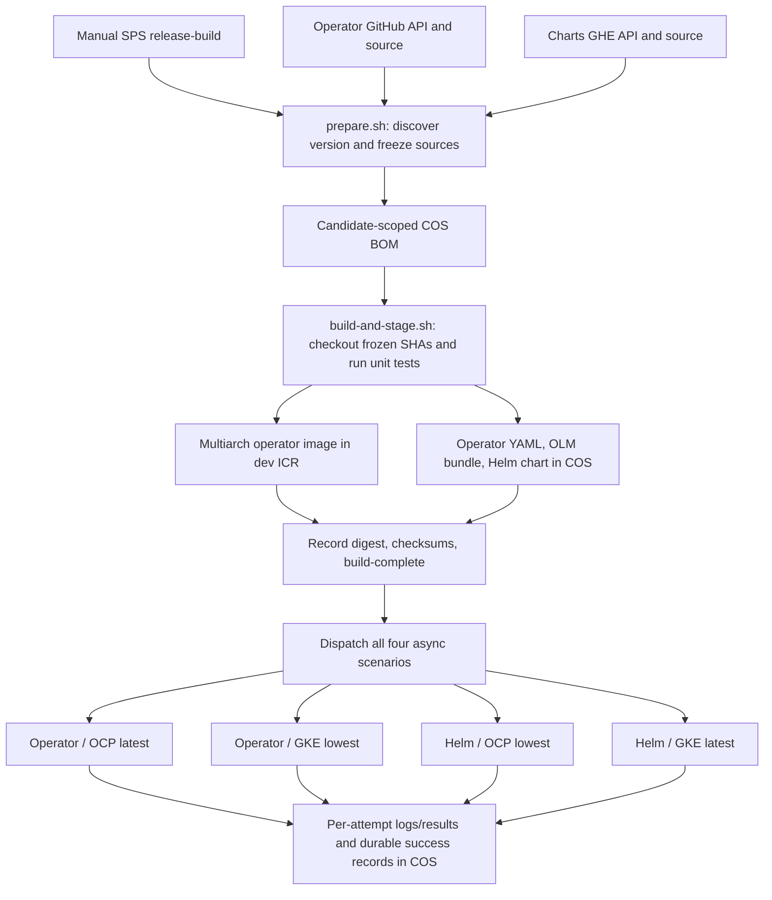
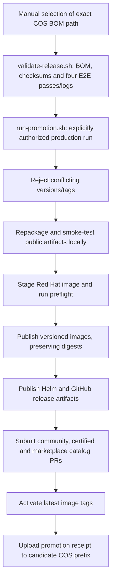

# Unified release pipeline architecture

## Review and rollout boundaries

The release-build PR adds candidate creation and async E2E. The promotion
PR adds the production entrypoint and its pre-publication checks. Neither changes the
existing release publishers, Concourse triggers, or chart version-file ownership.
Retirement and deletion of legacy machinery belong to blocked cleanup PRs.

The companion charts branch is also named `release-build-unified`. Both source
repositories must contain build support before using their `main` branches for a
candidate. For development, set both source-branch properties explicitly.

## Build and asynchronous E2E



`prepare.sh` uses authenticated, paginated APIs to select the next patch on the
requested release line and the published OLM predecessor. It records operator and
charts SHAs under a unique timestamp/UUID candidate. Version selection is not a
reservation: another candidate can compute the same version.

`build-and-stage.sh` fetches and checks out those exact SHAs, installs Go from the
frozen operator checkout, runs unit tests, and builds amd64, arm64, s390x and
ppc64le images. It builds and validates the OLM bundle and packages the Helm chart
from the local operator manifest, not the latest public release.

The BOM binds both source SHAs, readable image tag, multiarch digest and artifact
checksums. Consumers select its exact path:
`pipeline-state/release-X.Y.Z/<timestamp>-<uuid>/bom.json`. There is no mutable
latest-candidate pointer. The initial BOM is updated during staging; consumers
must require `build-complete` and verify its recorded content.

Each `e2e-async.sh` invocation has its own workspace, authenticates independently,
acquires a cluster reslock, verifies candidate inputs and runs one installer suite.
Helm suites download the staged chart and authenticate private image pulls. They
set `EXPECT_CUSTOM_ETCD_CA=true` because this candidate includes the precedence
fix; standalone charts CI retains its public-operator expectation until cutover.

Evidence contains candidate identity, source SHAs, image digest, checksums and a
checksummed log path. Failed attempts cannot replace the durable successful record.
One matching successful attempt per scenario is sufficient. Cleanup, lock release
and evidence upload are attempted on failure/termination, but SIGKILL can prevent
finalizers from running. A green build entrypoint means **build and dispatch**
succeeded, not that the four asynchronous E2E suites passed.

## Configuration and operation

Use `ci/.pipeline-config-release-build.yaml` in an SPS simple-execute pipeline.
Required properties are `release-line` (`MAJOR.MINOR`) and `cos-bucket-name`;
`cos-region` defaults to `us-south`. `release-branch-operator` and
`release-branch-charts` default to `main`. The build image and Docker socket are
specified in the configuration. GitHub and GHE access use separate `github-token`
and `ghe-token` secrets; COS uses `ibmcloud-api-key`. Cluster/backend and registry
credentials must be provisioned for async runners as required by their scripts.

Keep PR compliance pipelines enabled: this flow intentionally does not duplicate
their compliance tasks. Confirm the actual cluster versions behind lowest/latest
labels rather than treating resource names as proof of coverage. Finish the charts
changelog before freezing the final release candidate.

Save the exact BOM path printed by the build. Restart only failed E2E scenarios
against the same candidate; rebuilding creates a different candidate and its
evidence cannot be mixed with the old one. Do not publish from this build pipeline.

## Local checks and evidence

```bash
PYTHONDONTWRITEBYTECODE=1 python3 -m unittest discover -s ci/sps-scripts -v
```

Run `make manifests generate` in a fresh checkout before Go and real-artifact
checks; generated CRDs and DeepCopy files are not checked in.
The real Helm/yq fixture additionally needs Helm, yq v4, rsync and PyYAML, the
companion charts checkout at `../instana-agent-charts`, and
`RELEASE_TEST_TOOL_DIR` pointing to the Helm/yq binaries. Service calls in shell
regressions are guarded/mocked. These checks do not replace fresh SPS/E2E runs.

The original combined branches remain untouched for comparison. Their build and
promotion-validation runs are historical evidence tied to their frozen SHAs;
rewritten commits require fresh qualification. No production promotion has run.

## Promotion: check and prepare before publication



Promotion uses an exact `release-state-path` ending in `bom.json`. Its candidate
gate requires a completed build, both source branches recorded as `main`, checksummed artifacts,
and one candidate-matching success record plus checksummed log for every scenario.
`skip-e2e-check=true` bypasses only E2E, is recorded, and is an emergency decision.
It does not bypass artifact, version or branch integrity checks.

Promotion prepares deterministic public Helm, operator YAML and OLM archives,
then runs real Helm lint/template and manifest/CSV/CRD checks before the first
registry push or other publication. Failed checksum, repackaging or smoke checks
stop the run without publishing. GitHub `check-tags` rejects write requests locally.
The separate credential-validation pipeline has been retired after qualification;
production artifact checks remain mandatory and have no branch overrides.

Production (`ci/.pipeline-config-release-promotion.yaml`) is manual, must have SPS
concurrency limited to one, and must not run alongside the legacy publishers.
It publishes the frozen digest rather than rebuilding. Matching existing tags,
images, assets and catalog PRs support retry; conflicting content fails closed.
Publication is not transactional. Recover with the **same candidate**, never a
new build under the same version. `latest` is updated only after the required
publications and catalog PR submissions; a submitted PR is not proof of catalog
merge or acceptance. A receipt-upload failure can occur after publication.

See [the detailed contract](RELEASE-PIPELINE-DESIGN.md) for properties, credentials
and retry behavior, and [the historical readiness review](RELEASE-PIPELINE-READINESS.md)
for earlier evidence. These files are not a substitute for fresh qualification.

## Review and cutover order

1. Review operator release-build with charts support on `release-build-unified`.
2. Review `release-promotion-unified` against `main`, which includes release-build.
3. Qualify build, all E2E scenarios, artifact checks and isolated publication/recovery.
4. Approve a coordinated cutover; apply/pause deployed legacy jobs and triggers.
5. Only then merge blocked `release-cleanup-unified` PRs in both repositories.

No change to deployed SPS/Concourse configuration or production execution is
authorized by introducing these source files. Keep the original combined branches
for reference and rollback analysis.
